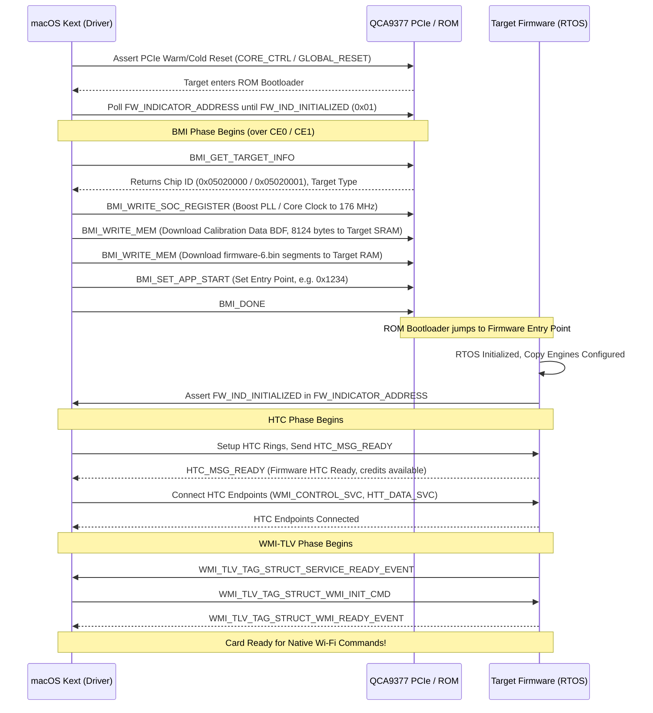

# 02. Firmware Subsystem, Loading Protocol and Boot Sequence

## 1. Overview of Firmware Architecture

The Qualcomm Atheros QCA9377 does not run fully autonomous firmware from on-board flash ROM. The silicon contains only a primitive factory ROM bootloader. The operating firmware, calibration data, and MAC configuration must be uploaded by the host operating system upon every boot, wake from sleep, and hardware recovery cycle.

This document details the exact protocols, binary container layouts, and hardware handshake procedures required to boot:
1. **The Wi-Fi Subsystem** (using BMI over PCIe Copy Engine).
2. **The Bluetooth Subsystem** (using QCA DFU vendor transfers over USB).

---

## 2. Wi-Fi Firmware Ecosystem & Binary Artifacts

In the repository firmware directory (`firmware/ath10k/QCA9377/hw1.0/`), the Wi-Fi subsystem requires the following binary assets:

```
firmware/ath10k/QCA9377/hw1.0/
├── board-2.bin               (Multi-board calibration database, ~300 KB)
├── board.bin                 (Fallback raw calibration data, exactly 8,124 bytes)
├── firmware-5.bin            (WMI-TLV Firmware API 5, ~780 KB)
└── firmware-6.bin            (WMI-TLV Firmware API 6, ~750 KB)
```

### 2.1 Firmware Image Formats (API 5 vs. API 6)
Qualcomm firmware files are packaged using a TLV (Tag-Length-Value) container format (`ATH10K_FW_IE_` tags):
- `ATH10K_FW_IE_FW_VERSION`: C-string identifying build and version.
- `ATH10K_FW_IE_TIMESTAMP`: Compilation timestamp.
- `ATH10K_FW_IE_FEATURES`: Bitmap of firmware capabilities (`ATH10K_FW_FEATURE_WMI_10_4`, `ATH10K_FW_FEATURE_NON_BMI`, etc.).
- `ATH10K_FW_IE_FW_IMAGE`: Raw firmware executable payload (composed of Xtensa ELF code/data segments or flat binary blocks loaded into target SRAM/DRAM).
- `ATH10K_FW_IE_WMI_OP_VERSION`: Identifies WMI operational protocol (`ATH10K_FW_WMI_OP_VERSION_TLV`).

**Recommended Firmware for macOS Kext**:
`firmware-6.bin` (Firmware API 6) is the most modern, stable, and feature-complete firmware for QCA9377 hw1.0 / hw1.1. It features optimized power-save routines, enhanced scan filtering, and reduced host-target messaging overhead.

### 2.2 Board Data File (BDF) & Calibration Architecture
The Board Data File contains factory-calibrated RF analog tuning parameters specific to the RF circuit layout and antenna implementation:
- **Cal Data Length**: Exactly **8,124 bytes** (`QCA9377_BOARD_DATA_SZ = 8124`).
- **Contents**:
  - Target MAC address (overridden by host if programmed in OTP / ACPI / OS).
  - Power amplifier (PA) gain curves for 2.4 GHz and 5 GHz channels.
  - Low-noise amplifier (LNA) gain steps.
  - Thermal compensation curves.
  - Regulatory domain limits and Transmit Power Control (TPC) limits per channel.
- **Board Selection Algorithm**:
  `board-2.bin` contains multiple BDF entries indexed by:
  ```
  bus=pci,bmi_chip_id=0,bmi_board_id=XX,variant=YY
  ```
  During the BMI phase, the driver queries `bmi_chip_id` and `bmi_board_id`. If matching BDF is not found in `board-2.bin`, the driver falls back to raw `board.bin`.

---

## 3. Wi-Fi Bootloader Messaging Interface (BMI) Protocol

During initial power-up or after chip reset, the target Xtensa core executes code from internal ROM. In this state, the chip only understands the **Bootloader Messaging Interface (BMI)** protocol.

### 3.1 BMI Command Set
BMI commands are simple structured requests exchanged via the host interface:

| Command Name | Value | Purpose |
| :--- | :--- | :--- |
| `BMI_NO_COMMAND` | `0` | No operation / padding. |
| `BMI_DONE` | `1` | Informs target that bootloader phase is complete; target jumps to firmware entry point. |
| `BMI_READ_MEM` | `2` | Reads a block of target memory (SRAM/DRAM/registers). |
| `BMI_WRITE_MEM` | `3` | Writes a block of data to target memory address. |
| `BMI_EXECUTE` | `4` | Instructs target CPU to execute code at specified address. |
| `BMI_SET_APP_START` | `5` | Sets the start address of the application firmware. |
| `BMI_READ_SOC_REGISTER` | `6` | Direct 32-bit register read from SoC AXI space. |
| `BMI_WRITE_SOC_REGISTER`| `7` | Direct 32-bit register write to SoC AXI space. |
| `BMI_GET_TARGET_INFO` | `8` | Queries target version, chip ID, and target type. |

### 3.2 Transporting BMI over PCIe
In PCIe-based QCA9377 hardware, BMI messages **do not** use raw register polling; they are exchanged through the **Copy Engine (CE)** DMA subsystem:
- **Transmit Pipe**: Copy Engine 0 (CE0, Host -> Target).
- **Receive Pipe**: Copy Engine 1 (CE1, Target -> Host).
- Each BMI request is packaged into a DMA buffer, submitted to CE0, and the driver awaits a completion descriptor on CE1.

### 3.3 Complete Wi-Fi Firmware Boot Sequence
The following sequence diagram illustrates the exact state progression from PCIe power-on to operational state:



---

## 4. Bluetooth Subsystem Firmware Loading Protocol

The Bluetooth controller is an integrated Rome core connected over USB. Unlike Wi-Fi which uses BMI over PCIe, Bluetooth firmware is loaded using the **Qualcomm Bluetooth DFU (Device Firmware Upgrade)** protocol over USB.

### 4.1 Required Firmware Artifacts
From `firmware/qca/`:
1. `rampatch_usb_00000302.bin`: Firmware patch code for Rome 3.2 (~68 KB).
2. `nvm_usb_00000302.bin`: Non-Volatile Memory table containing crystal calibration, BD_ADDR, and RF configurations (~6.3 KB).

### 4.2 Detection & Identification via USB Vendor Request
Before downloading, the driver must verify target ROM version:
- **Request Type**: USB Vendor Request IN (`USB_TYPE_VENDOR | USB_DIR_IN = 0xC0`)
- **Request ID**: `QCA_GET_TARGET_VERSION` (`0x05`)
- **Value**: `0x0000`, **Index**: `0x0000`, **Length**: `sizeof(struct qca_version)` (typically 12 to 16 bytes).
- **Structure Returned**:
  ```c
  struct qca_version {
      __le32 rom_version;    /* Must match 0x00000302 for Rome 3.2 / QCA9377 */
      __le32 patch_version;  /* Current patch revision (0 if unpatched) */
      __le32 ram_version;    /* RAM revision */
      __le32 ref_clock;      /* Reference clock freq (e.g. 40 MHz) */
  };
  ```

### 4.3 Rampatch Download Protocol
If `rom_version == 0x00000302` and the patch is not yet applied:
1. **Header Phase (Control Transfer)**:
   - The rampatch file begins with a header (typically 28 bytes for Rome 3.2).
   - Sent via USB Control Request:
     - Request Type: `USB_TYPE_VENDOR | USB_DIR_OUT` (`0x40`)
     - Request ID: `QCA_DFU_DOWNLOAD` (`0x01`)
     - Index: `0x0000`
     - Data: First 28 bytes of `rampatch_usb_00000302.bin`.
2. **Payload Phase (Bulk Transfer)**:
   - The remainder of the patch binary is streamed to the device in blocks (up to 4096 bytes per USB bulk transfer) via **Bulk OUT Endpoint (EP2 OUT)**.
3. **Verification**:
   - Send Vendor Request `QCA_CHECK_STATUS` (`0x04`).
   - Response bit `QCA_PATCH_UPDATED` (`0x01`) must be asserted.

### 4.4 NVM (Non-Volatile Memory) Injection Protocol
Following the rampatch:
1. **NVM Header & Payload**:
   - Similar to rampatch, `nvm_usb_00000302.bin` is sent via `QCA_DFU_DOWNLOAD` (header via EP0 control transfer, body via EP2 bulk transfer).
   - During NVM injection, the driver can dynamically patch the **BD_ADDR (Bluetooth Device Address / MAC)** within the NVM buffer so that the device receives a valid, unique MAC address.
2. **Verification & Activation**:
   - Send Vendor Request `QCA_CHECK_STATUS` (`0x04`).
   - Response bit `QCA_SYSCFG_UPDATED` (`0x02`) must be asserted.
3. **Reset & Handoff**:
   - The controller executes an internal soft reset (`msleep(100)`).
   - When the controller resets, it reappears as a fully capable, compliant Bluetooth 4.2 / 5.0 HCI controller.
   - The firmware loader kext detaches from the USB device, allowing macOS's native `IOBluetoothHostControllerUSBTransport` to match and take ownership.

---

## 5. Firmware Fault Detection & Recovery

Both Wi-Fi and Bluetooth firmware subsystems incorporate watchdog and crash reporting mechanisms:

### 5.1 Wi-Fi Crash Recovery (FW Indicator & CE Crashdump)
- If target firmware encounters an unhandled Xtensa exception (watchdog timeout, assertion failure, memory corrupt), it writes:
  ```c
  val |= FW_IND_EVENT_PENDING;
  ```
  to `FW_INDICATOR_ADDRESS` (`0x180C` or RTC offset).
- It generates an interrupt on CE7 / CE_DIAG_PIPE.
- The host kext reads the crash dump buffer via `ath10k_pci_hif_diag_read` or CE diagnostic window and performs a warm PCIe reset to recover without requiring a system reboot.

### 5.2 Bluetooth Watchdog Recovery
- If the Bluetooth controller hangs or loses synchronization over USB:
  - The driver issues HCI Reset (`0x03 0x0C 0x00`) or USB port reset (`IOUSBHostDevice::reset()`).
  - Upon port reset, the ROM reboots, and the firmware loader re-injects the rampatch and NVM.
