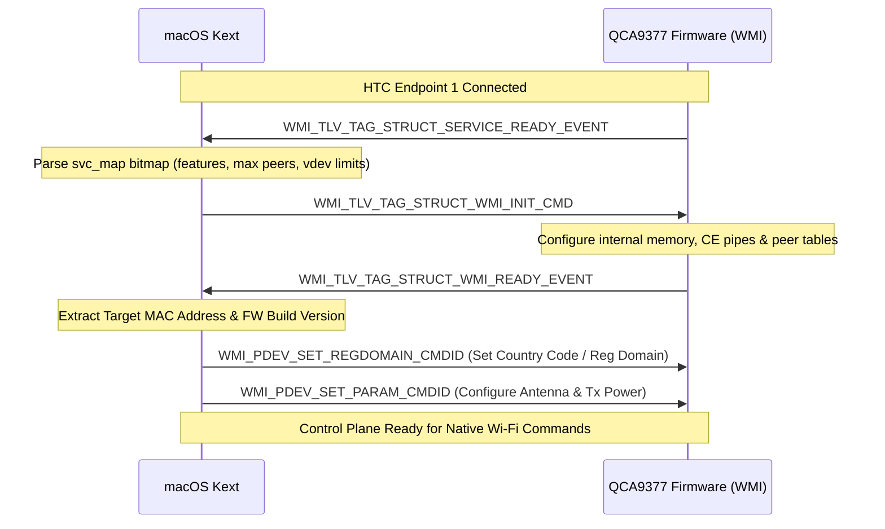

# 04. WMI-TLV Control Plane and 802.11 State Machine

## 1. Overview of the WMI-TLV Architecture

The **Wireless Module Interface (WMI)** is the high-level control protocol running over HTC. While early Qualcomm Atheros chips (such as the QCA9880 / AR988x) used fixed binary C-struct WMI messages, the **QCA9377** uses **WMI-TLV (Type-Length-Value)** framing.

In WMI-TLV, every command, event, and configuration structure is wrapped in standardized TLV blocks. This decoupling allows the target firmware and host driver to evolve independently without binary ABI incompatibilities.

```
       +-----------------------------------------------------------+
       |                     HTC Frame Header                      |
       |  - Endpoint: 1 (WMI_CONTROL_SVC)                          |
       |  - Length: Total WMI Message Length                       |
       +-----------------------------------------------------------+
                                     |
                                     v
       +-----------------------------------------------------------+
       |                     WMI Command Header                    |
       |  - Command ID (e.g. WMI_START_SCAN_CMDID)                  |
       +-----------------------------------------------------------+
                                     |
                                     v
       +--------------------+------------------+-------------------+
       | TLV 1: Tag | Len   | TLV 2: Tag | Len | TLV 3: Tag | Len  |
       | Fixed Param Struct | Array of Channels| Array of SSIDs    |
       +--------------------+------------------+-------------------+
```

### 1.1 TLV Framing Specification
Every TLV container within a WMI message consists of a 4-byte header followed by 32-bit aligned data:
- **Tag (16 bits)**: Unique identifier defined in `enum wmi_tlv_tag` (e.g. `WMI_TLV_TAG_STRUCT_START_SCAN_CMD`, `WMI_TLV_TAG_ARRAY_UINT32`).
- **Length (16 bits)**: Length of payload in bytes (excluding the 4-byte TLV header).
- **Value (variable)**: Data payload padded with zeros to ensure alignment to 4-byte boundaries.

---

## 2. Driver-Firmware Handshake & Initialization Sequence

Once HTC is established, the target firmware and host driver execute a strict two-way handshake to negotiate operational parameters.



### 2.1 Service Ready Event (`WMI_SERVICE_READY_EVENT`)
The firmware initiates the WMI dialog by sending `WMI_TLV_TAG_STRUCT_SERVICE_READY_EVENT`:
- **Capabilities Bitmap (`svc_map`)**: Informs the host which features are enabled (e.g., `WMI_SERVICE_COEX_GPIO`, `WMI_SERVICE_RX_FULL_REORDER`, `WMI_SERVICE_STA_ADVANCED_PWRSAVE`).
- **Target Limits**:
  - `max_peers`: Maximum supported peer stations (typically 15 for QCA9377 client mode).
  - `max_vdevs`: Maximum concurrent virtual interfaces (typically 4: 1 STA + 1 P2P-Dev + 1 P2P-Client/GO + 1 Monitor).
  - `ast_skid_limit`: Address Search Table limits (0x10).

### 2.2 Host Init Command (`WMI_INIT_CMD`)
In response to `SERVICE_READY`, the driver issues `WMI_INIT_CMD` containing:
- Host memory allocation tables for firmware peer tracking.
- Desired number of active VDEV interfaces.
- Copy Engine pipe buffer size confirmations.

### 2.3 Ready Event (`WMI_READY_EVENT`)
Firmware acknowledges the initialization with `WMI_READY_EVENT`:
- Confirms successful allocation of target resources.
- Provides the factory programmed **Target MAC Address**.

---

## 3. Virtual Device (VDEV) Management

In QCA9377 firmware, physical MAC resources are abstracted into **Virtual Devices (VDEVs)**. All scanning, association, power management, and key installation operations are scoped to a specific `vdev_id` (typically `vdev_id = 0` for primary STA mode).

### 3.1 VDEV Lifecycle Operations

| Operation | WMI Command ID | Description |
| :--- | :--- | :--- |
| **Create VDEV** | `WMI_VDEV_CREATE_CMDID` | Allocates virtual interface, sets mode (`WMI_VDEV_TYPE_STA`), and assigns MAC address. |
| **Start VDEV** | `WMI_VDEV_START_REQUEST_CMDID` | Configures operating channel, frequency, channel width (20/40/80 MHz), beacon interval, and DTIM period. |
| **Restart VDEV**| `WMI_VDEV_RESTART_REQUEST_CMDID` | Dynamic channel/bandwidth change (e.g. following AP channel switch announcement). |
| **Stop VDEV** | `WMI_VDEV_STOP_CMDID` | Halts transmission and disassociates from current BSS. |
| **Delete VDEV** | `WMI_VDEV_DELETE_CMDID` | Frees the virtual device instance from target memory. |

---

## 4. Scanning & Network Discovery Subsystem

When macOS issues a network scan request (e.g. via `APPLE80211_IOC_SCAN_REQ` or periodic background scanning for location services), the request is translated into a WMI scan command.

### 4.1 Scan Command Parameters (`WMI_START_SCAN_CMDID`)
The scan request TLV encapsulates:
- **Scan Type**: Active scanning (sends Probe Requests) or Passive scanning (listens for Beacons).
- **Dwell Times**:
  - Active Channel Dwell Time: **25 ms - 40 ms**.
  - Passive Channel Dwell Time: **100 ms - 110 ms**.
- **Channel List**: Array of 2.4 GHz and 5 GHz channel frequencies (e.g. 2412, 2437, 2462, 5180, 5200, 5745 MHz).
- **Probe Request Template**: 802.11 Probe Request frame template containing the host MAC and supported rates.

### 4.2 Scan Event Processing & Beacon Ingestion
1. During the scan, firmware switches channels and transmits probe requests.
2. When beacons or probe responses are detected:
   - Firmware packages the raw 802.11 management frame into a `WMI_TLV_TAG_STRUCT_MGMT_RX_HDR` event.
   - The event contains RSSI, SNR, timestamp, channel frequency, and the raw 802.11 frame payload (including SSID, BSSID, RSN IE, and HT/VHT Information Elements).
3. The host driver parses the Information Elements (IEs) and constructs macOS `apple80211_scan_data` entries.
4. When all channels have been scanned, firmware generates `WMI_SCAN_EVENTID` with code `WMI_SCAN_EVENT_COMPLETED`.
5. Driver signals completion to macOS by calling `IO80211Interface::postMessage(APPLE80211_M_SCAN_DONE)`, prompting macOS to update the Wi-Fi menu bar.

---

## 5. Association & Peer State Machine

Connection to an Access Point involves transitioning through three distinct phases:

```
[ Unassociated ] 
       |
       | 1. WMI_VDEV_START_REQUEST_CMDID (Set SSID, BSSID, Channel)
       v
[ VDEV Started / Channel Active ]
       |
       | 2. WMI_PEER_CREATE_CMDID (Create Peer for AP MAC)
       v
[ Peer Created ]
       |
       | 3. WMI_PEER_ASSOC_CMDID (Set AID, Capabilities, HT/VHT parameters)
       v
[ Associated / 802.1X Auth Pending ]
       |
       | 4. WMI_VDEV_INSTALL_KEY_CMDID (Install PTK & GTK Encryption Keys)
       v
[ Fully Authenticated / Link Up ]
```

### 5.1 Peer Association Command (`WMI_PEER_ASSOC_CMDID`)
Informs target firmware of AP properties:
- **Association ID (AID)** assigned by AP.
- **Listen Interval**: Beacon interval multiplier for power-save wakeups.
- **HT/VHT Capabilities**: Guard Interval (Short GI), 40 MHz / 80 MHz channel widths, single spatial stream (NSS = 1 for QCA9377).

---

## 6. Cryptography & Hardware Key Installation

The QCA9377 features on-chip hardware cryptographic engines supporting **AES-CCMP (128-bit)**, **TKIP**, and legacy **WEP**.

### 6.1 Key Installation Protocol (`WMI_VDEV_INSTALL_KEY_CMDID`)
When the macOS RSN Supplicant completes the 4-way handshake, macOS passes the keys to the driver via `APPLE80211_IOC_KEY`:
1. **Pairwise Transient Key (PTK)**:
   - Key Index: `0`
   - Key Type: Unicast / Pairwise
   - Cipher: `WMI_CIPHER_AES_CCM` (0x04)
   - Length: 16 bytes (128 bits)
   - Target Hardware: Installed into the AP peer table; hardware automatically encrypts outbound unicast frames and decrypts inbound frames.
2. **Group Temporal Key (GTK)**:
   - Key Index: `1`, `2`, or `3`
   - Key Type: Multicast / Broadcast
   - Cipher: `WMI_CIPHER_AES_CCM` (0x04)
   - RSC: 6-byte Receive Sequence Counter (replay protection).
   - Target Hardware: Installed into the VDEV broadcast key table.

---

## 7. Power Management & Coexistence

### 7.1 Power Save Modes
- **Active Mode (`WMI_STA_PWRSAVE_MODE_DISABLED`)**: Full power, radio remains active.
- **802.11 Power Save (`WMI_STA_PWRSAVE_MODE_ENABLED`)**: Radio enters sleep between beacons; wakes up to check TIM / DTIM bitmaps in AP beacons.
- **Deep Sleep / WOW (Wake-on-WLAN)**: Low-power state during system sleep, supported via `WMI_WOW_ENABLE_CMDID`.

### 7.2 Wi-Fi / Bluetooth Hardware Coexistence
Because Wi-Fi and Bluetooth share the 2.4 GHz ISM radio spectrum and frequently share a single physical antenna (via an RF diplexer/switch inside the module), coexistence management is critical:
- The QCA9377 firmware runs an internal hardware coexistence arbiter (`WMI_SERVICE_COEX_GPIO`).
- Priority is granted dynamically:
  - High Priority: Bluetooth eSCO voice packets and inquiry/page scans.
  - Medium Priority: Wi-Fi beacon reception and 802.11 management frames.
  - Low Priority: Background Wi-Fi TCP/UDP data traffic.
- The host driver enables coexistence via `WMI_PDEV_SET_PARAM_CMDID` (`WMI_PDEV_PARAM_BTCOEX_ENABLE`), ensuring simultaneous Wi-Fi connectivity and Bluetooth audio streaming without packet collision or stutter.
